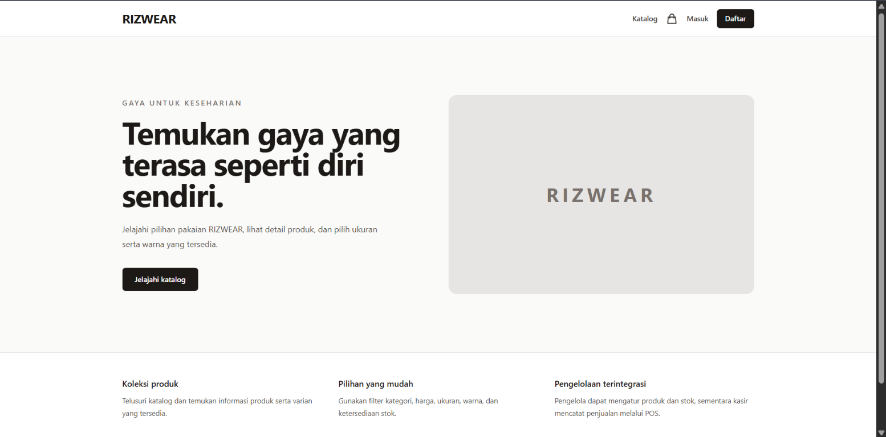
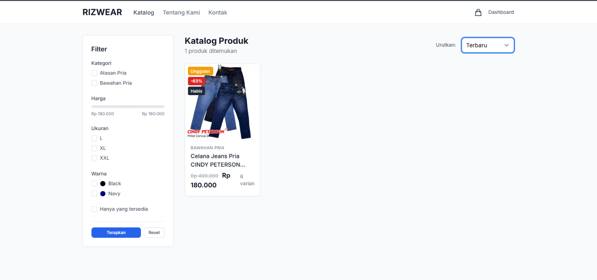
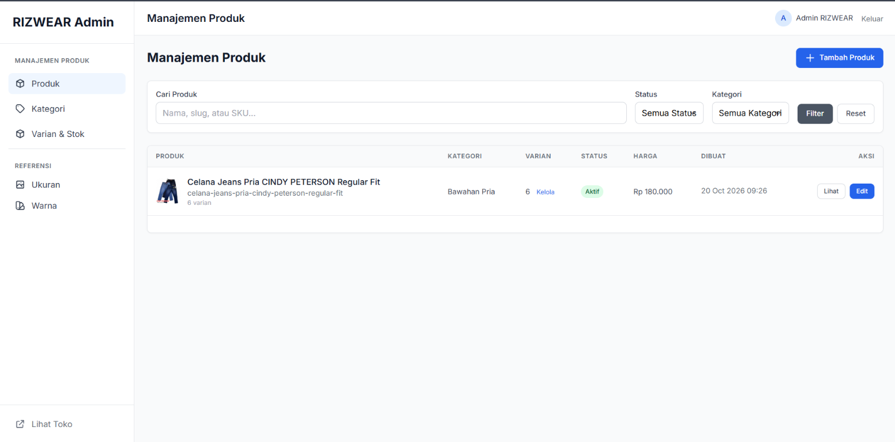
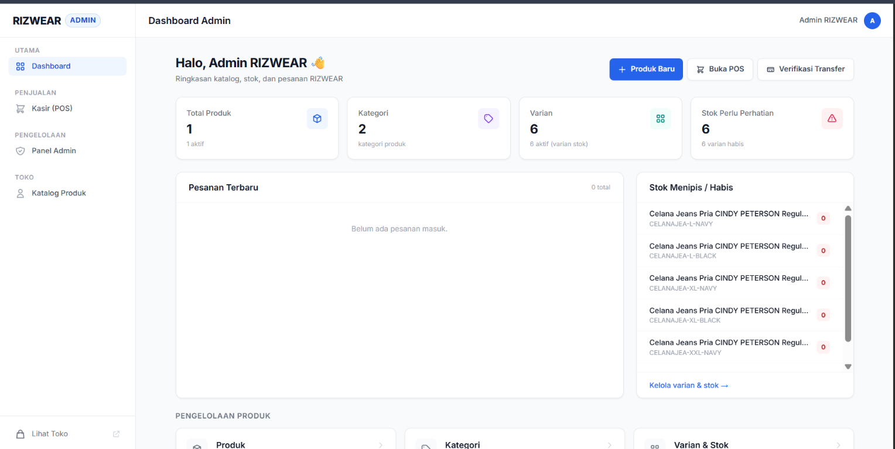
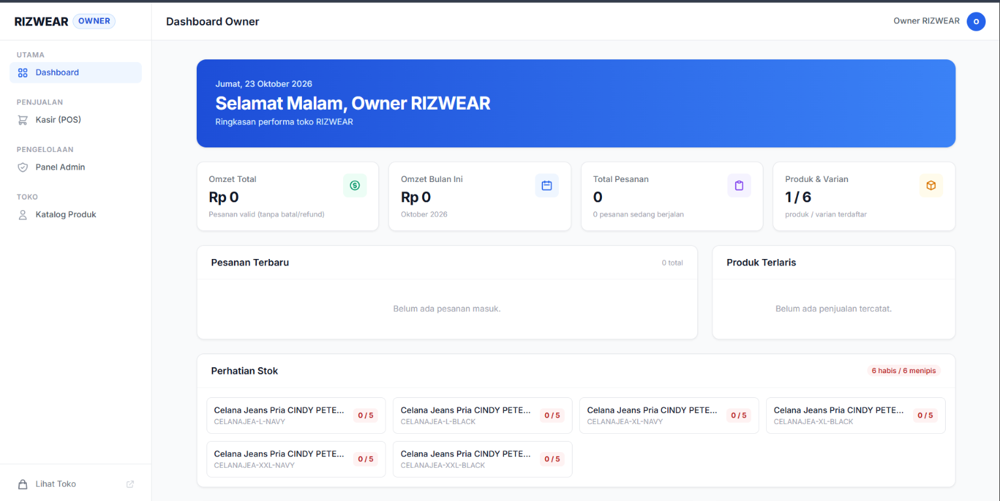

# RIZWEAR

RIZWEAR adalah aplikasi toko pakaian berbasis Laravel. Aplikasi ini menyediakan katalog produk untuk pengunjung serta fitur administrasi produk dan penjualan melalui Point of Sale (POS).

## Fitur

- Halaman beranda dan katalog produk.
- Filter katalog berdasarkan kategori, rentang harga, ukuran, warna, dan ketersediaan stok.
- Halaman detail produk, pemilihan varian ukuran/warna, dan keranjang belanja untuk tamu maupun pengguna terdaftar.
- Checkout COD dan transfer manual, validasi stok, pencatatan pesanan, dan riwayat pesanan pengguna.
- Verifikasi pembayaran transfer secara manual oleh admin/owner setelah pembayaran diterima.
- Autentikasi, registrasi, verifikasi email, dan pengelolaan profil.
- Dashboard yang menyesuaikan peran pengguna.
- Pengelolaan produk, gambar produk, kategori, ukuran, warna, varian, dan stok untuk admin/owner.
- POS untuk kasir, admin, dan owner, termasuk pencatatan penjualan dan validasi ketersediaan stok.
- Role dan permission untuk membatasi akses.

> **Catatan transfer manual:** aplikasi tidak terhubung ke payment gateway. Pengelola toko perlu memberikan informasi rekening secara terpisah, memeriksa pembayaran, lalu mengonfirmasikannya melalui menu **Verifikasi Transfer**.

## Teknologi

- PHP 8.2 atau lebih baru
- Laravel 11
- SQLite (konfigurasi awal) atau database lain yang didukung Laravel
- Node.js dan npm untuk membangun aset frontend

## Cara menjalankan di lokal

Pastikan PHP, Composer, Node.js, npm, serta ekstensi PHP yang dibutuhkan Laravel telah terpasang.

Jika membutuhkan akun demo owner/admin/kasir/customer, atur `RIZWEAR_DEMO_PASSWORD` di `.env` dengan kata sandi lokal minimal 12 karakter sebelum menjalankan seeder. Akun demo tidak dibuat jika variabel tersebut kosong.

```powershell
composer install
Copy-Item .env.example .env
New-Item -ItemType File -Force database/database.sqlite
php artisan key:generate
php artisan migrate --seed
php artisan storage:link
npm install
npm run build
php artisan serve
```

Buka alamat yang ditampilkan oleh `php artisan serve` (biasanya `http://127.0.0.1:8000`).

Lihat `database/seeders/AdminUserSeeder.php` untuk email akun demo. Akun demo hanya untuk pengembangan lokal dan jangan digunakan pada lingkungan publik.

Untuk mengembangkan aset frontend dengan Vite, jalankan `npm run dev` di terminal terpisah dari `php artisan serve`.

## Menjalankan pengujian

```powershell
php artisan test
```

Pengujian mencakup autentikasi, profil, dashboard, hak akses, pembuatan produk, dan transaksi POS.

## Screenshot

Screenshot berikut diambil dari aplikasi RIZWEAR:

### Beranda

Halaman utama toko untuk pengunjung. Menampilkan identitas RIZWEAR dan pintasan ke katalog, keranjang, login, serta pendaftaran.



### Katalog produk

Halaman katalog pelanggan. Terlihat daftar produk dan filter berdasarkan kategori, harga, ukuran, warna, serta ketersediaan stok.



### Manajemen produk

Halaman admin untuk mencari dan mengelola produk. Tabel menampilkan kategori, jumlah varian, status, harga, dan tindakan untuk melihat atau mengedit produk.



### Dashboard admin

Ringkasan untuk admin: jumlah produk, kategori, varian, kondisi stok, pesanan terbaru, serta pintasan untuk menambah produk, membuka POS, dan memverifikasi transfer.



### Dashboard owner

Ringkasan operasional untuk owner, termasuk omzet, jumlah pesanan, produk dan varian, produk terlaris, serta peringatan stok.



## Repo dan deployment

- **Repo GitHub:** [MuhammadRizaRaditya/web-toko_online](https://github.com/MuhammadRizaRaditya/web-toko_online)
- **Deployment:** belum dilakukan; akan disiapkan nanti jika diwajibkan untuk UTS.
